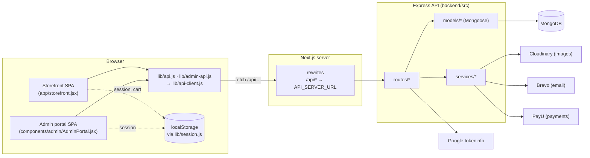
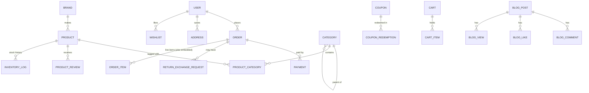

# Health with Herbal — Codebase Guide

One document that explains how this codebase is put together: what runs where,
how a request flows, where each kind of code lives, and the conventions to follow
when you change it. Read this before your first change; keep it up to date when
you change the architecture.

- [1. What this application is](#1-what-this-application-is)
- [2. Repository layout](#2-repository-layout)
- [3. Running it locally](#3-running-it-locally)
- [4. Architecture at a glance](#4-architecture-at-a-glance)
- [5. Frontend](#5-frontend)
- [6. Backend](#6-backend)
- [7. Verifying changes](#7-verifying-changes)
- [8. Known issues and follow-ups](#8-known-issues-and-follow-ups)
- [9. How-to recipes](#9-how-to-recipes)

---

## 1. What this application is

An online store for Ayurvedic and herbal wellness products, made of:

- **Storefront** (`/`): home, shop with filters, product pages, cart drawer,
  checkout (cash on delivery or PayU), order confirmation with live status,
  customer account (orders, addresses, returns/exchanges, reviews), wishlist,
  blog (likes, comments), and static content pages. Customers sign in with an
  emailed one-time code (OTP) or Google.
- **Admin portal** (`/admin`): dashboard, products and inventory (low stock),
  categories, brands, coupons, orders, payments, returns & exchanges, reviews,
  customers, blog posts and comments, staff users with per-page access,
  storefront settings (announcement bar, featured categories, returns toggle),
  and the admin's own profile.
- **API** (`/api`): an Express + MongoDB backend used by both.

## 2. Repository layout

```text
.
├── CODEBASE_GUIDE.md        ← this file
├── README.md                ← quick start
├── backend/                 ← Express 4 API (CommonJS), MongoDB via Mongoose 8
│   ├── src/
│   │   ├── server.js        ← entry: connect DB, start HTTP server, graceful shutdown
│   │   ├── app.js           ← Express app: security headers, CORS, body limits, routers, errors
│   │   ├── config.js        ← the only place that reads process.env
│   │   ├── db.js            ← MongoDB connection + index maintenance
│   │   ├── routes/          ← HTTP endpoints, grouped by area (store, auth, user, orders, admin*)
│   │   ├── controllers/     ← larger handlers extracted from routes (password reset)
│   │   ├── middleware/      ← asyncHandler, errorHandler, validate, adminAuth, userSession, page access
│   │   ├── services/        ← integrations & business logic (Brevo, Cloudinary, PayU, inventory, pricing)
│   │   ├── models/          ← Mongoose schemas (one file per collection)
│   │   ├── constants/       ← roles, statuses, inventory log types, admin pages
│   │   └── utils/           ← small generic helpers (AppError, crypto, http, dates, strings, ...)
│   ├── scripts/             ← one-off maintenance scripts (DB init, Cloudinary migration, API smoke tests)
│   ├── uploads/             ← static files served at /uploads (brand logos)
│   └── REFACTOR_AUDIT.md    ← backend audit notes
└── frontend/                ← Next.js 15 App Router, React 19, JavaScript/JSX
    ├── next.config.ts       ← URL rewrites (pretty URLs → storefront pages, /api → backend)
    ├── AGENTS.md            ← rules for automated/AI contributors (also good human rules)
    ├── FRONTEND_AUDIT.md    ← frontend audit notes
    └── src/
        ├── app/             ← Next.js routes + page modules (see §5.2)
        ├── components/      ← UI components (see §5.2)
        ├── hooks/           ← shared React hooks
        ├── lib/             ← API client + services, browser storage, cross-tab sync
        └── constants/       ← shared constants (statuses, admin pages, storage keys, badges)
```

## 3. Running it locally

Requirements: Node.js 20+ (24 is used in development), MongoDB 6+.

```bash
# 1. API
cd backend
npm install
# create backend/.env (never commit it) with at least:
#   MONGODB_URI=mongodb://127.0.0.1:27017/healthwithherbal
#   ADMIN_SESSION_SECRET=<random string, 32+ characters>
#   ADMIN_EMAIL=<root admin email>   ADMIN_PASSWORD=<root admin password>
npm run db:init        # create collections and indexes
npm run dev            # http://localhost:4000/api/health

# 2. Web
cd ../frontend
npm install
npm run dev            # http://localhost:3000 (storefront), http://localhost:3000/admin
```

The frontend calls `/api/...` on its own origin; `next.config.ts` proxies those
requests to `API_SERVER_URL` (default `http://127.0.0.1:4000/api`). Set
`NEXT_PUBLIC_API_URL` only if the browser must call the API on another origin.

The root admin account is the `admin` user in the database whose email matches
`ADMIN_EMAIL`; it signs in with `ADMIN_PASSWORD` until it sets its own password.
Without `BREVO_API_KEY` the API runs in **email simulation mode**: emails are
printed to the API console and the sign-in code is returned to the browser as a
"Dev Mode Preview" so you can sign in locally.

### Configuration reference

| Variable | Where | Purpose |
|---|---|---|
| `MONGODB_URI` | backend | **Required.** MongoDB connection string. |
| `PORT` | backend | API port (default 4000). |
| `NODE_ENV` | backend | `production` disables the localhost CORS origins. |
| `WEB_ORIGIN` | backend | Comma-separated allowed browser origins (CORS). |
| `ADMIN_SESSION_SECRET` | backend | **Required (32+ chars).** Signs admin and customer session tokens. |
| `ADMIN_EMAIL`, `ADMIN_PASSWORD` | backend | Root admin credentials. |
| `STORE_TIME_ZONE` | backend | Business time zone for reports (default `Asia/Kolkata`). |
| `GOOGLE_CLIENT_ID` | backend | Enables Google sign-in verification. |
| `BREVO_API_KEY`, `BREVO_SENDER_EMAIL`, `BREVO_SENDER_NAME` | backend | Transactional email. Unset = simulation mode. |
| `CONTACT_EMAIL` | backend | Inbox for contact-form and return/exchange emails. |
| `PAYU_KEY`, `PAYU_SALT`, `PAYU_ENVIRONMENT`, `PAYU_CALLBACK_URL` | backend | PayU hosted checkout (see `backend/README.md`). |
| `CLOUDINARY_CLOUD_NAME`, `CLOUDINARY_API_KEY`, `CLOUDINARY_API_SECRET`, `CLOUDINARY_FOLDER` | backend | Image uploads. Required for uploads. |
| `API_SERVER_URL` | frontend (build + server) | Where Next.js proxies `/api/*`. |
| `NEXT_PUBLIC_API_URL` | frontend (browser) | API base URL used by the browser (default `/api`). |
| `NEXT_PUBLIC_GOOGLE_CLIENT_ID` | frontend | Shows the Google sign-in button. |
| `NEXT_PUBLIC_STORE_TIME_ZONE` | frontend | Time zone for admin date formatting. |

## 4. Architecture at a glance



- Both the storefront and the admin portal are **client-rendered single-page
  apps** mounted by thin Next.js route files with `dynamic(..., { ssr: false })`.
  Next.js mainly provides routing entry points, the `/api` proxy, bundling and
  the static assets.
- Every network call from the browser goes through `lib/api-client.js`.
- The backend is a conventional Express app: routers → middleware → Mongoose
  models, with external integrations isolated in `services/`.

## 5. Frontend

### 5.1 Routing

Next.js route files (`src/app/**/page.jsx`) are entry points only:

| URL | Route file | Renders |
|---|---|---|
| `/` and every storefront URL | `app/page.jsx` | `app/storefront.jsx` (client only) |
| `/admin` | `app/admin/page.jsx` | `components/admin/AdminPortal.jsx` (client only) |
| `/account/orders/[orderId]`, `/account/orders/[orderId]/invoice` | `app/account/orders/...` | the storefront, on the order details / invoice page |
| `/forgot-password`, `/reset-password` | `app/(auth)/...` | admin password reset forms |

Pretty storefront URLs are rewritten in `next.config.ts` to `/?page=...`
(`/shop`, `/product/:slug`, `/blog/:slug`, `/pages/:slug`, `/checkout`,
`/account`, `/wishlist`, `/order-confirmation`). Inside the storefront, page
changes use the History API (`pushState`/`popstate`); the current page is
derived from the URL. The admin portal keeps its page in `?page=<slug>&q=<search>`
and remembers the last page/search in local storage.

### 5.2 Where code lives (component architecture)

Every page is assembled from components; state and side effects live in
hooks. Page files read like an outline: call a hook, render named sections.

```text
src/
├── app/                                   Next.js routes and page modules
│   ├── page.jsx, storefront.jsx           storefront entry + shell (composes the shell hooks)
│   ├── (pages)/<page>/<page>-page.jsx     storefront pages (thin compositions)
│   ├── admin/page.jsx                     admin portal entry
│   ├── admin/(dashboard)/<area>/*Page.jsx admin page modules (thin compositions)
│   └── (auth)/                            admin forgot/reset password routes
├── components/
│   ├── pages/                             storefront UI, one folder per feature
│   │   ├── storefront/                    shell hooks (cart, wishlist, session, store data, navigation, toast) + StorefrontPages
│   │   ├── layout/                        Header (header/), Footer (footer/), announcement bar
│   │   ├── shared/                        storefront primitives: AppButton, Rating, SectionHeading, ProductCard, ProductGrid
│   │   ├── sections/home/, shop/, product/, wishlist/
│   │   ├── cart/, checkout/               cart drawer parts; checkout steps and summary
│   │   ├── orders/, account/              order confirmation/details/invoice; account tabs
│   │   ├── auth/, blog/, content/         sign-in steps; blog list/article; static pages (copy in content-data.js)
│   │   └── modals/                        modal entry points and their parts (product-review/, return-exchange/)
│   ├── admin/                             admin UI
│   │   ├── AdminPortal.jsx + portal/      portal shell and hooks (session, notifications, page data, URL state, mutations)
│   │   ├── global/                        Modal, FormModal (form-modal/, form-fields/, form-schemas/, markdown-editor/),
│   │   │                                  DeleteConfirmationModal, header/, sidebar/, login/, PageStats, admin-utils.js
│   │   ├── tables/                        DataTable, TablePagination, row actions + one folder per entity table
│   │   ├── stats/, dashboard/, forms/     page stat cards; dashboard widgets; entity forms (image-upload/)
│   │   └── returns/, payments/, settings/, low-stock/, customers/, users/, blogs/, categories/, profile/
│   └── shared/                            cross-app primitives: FormField, StatusBadge
├── hooks/                                 generic shared hooks (useAsyncResource)
├── lib/                                   API client and services, browser storage, cross-tab sync (§5.3–5.5)
└── constants/                             statuses, admin pages, storage keys, status badges
```

Where to find things:

| Feature | Entry file | Components | State lives in |
|---|---|---|---|
| Storefront shell | `app/storefront.jsx` | `pages/storefront`, `pages/layout` | `useCart`, `useWishlist`, `useCustomerSession`, `useStoreData`, `useStorefrontNavigation` |
| Home, shop, product, wishlist | `app/(pages)/{home,shop,products,wishlist}` | `pages/{sections/home,shop,product,wishlist,shared}` | `useHomeProducts`, `useShopCatalog`, `useShopFilters`, `useProductReviews` |
| Cart drawer | `pages/modals/CartDrawer.jsx` | `pages/cart` | `useCartDrawer` (+ coupons, shipping estimate, backend sync) |
| Checkout | `app/(pages)/checkout/checkout-page.jsx` | `pages/checkout` | `useCheckout` (+ addresses, coupon) |
| Order confirmation, details, invoice | `app/(pages)/order-confirmation/*` | `pages/orders` | `useOrderSource`, `useLiveOrder`, `useInvoiceOrder` |
| Customer account | `app/(pages)/account/account-page.jsx` | `pages/account` | `useAccountData`, `useAddressBook`, `useReturnRequest` |
| Sign-in | `pages/modals/AuthModal.jsx` | `pages/auth` | `useAuthFlow`, `useGoogleSignIn` |
| Blog, content pages | `app/(pages)/{blog,content}` | `pages/{blog,content}` | `useBlogPosts`, `useBlogCommunity`, `useContactForm` |
| Admin portal | `admin/AdminPortal.jsx` | `admin/portal`, `admin/global` | `useAdminPortal` (composes the portal hooks) |
| Admin pages | `app/admin/(dashboard)/*` | `admin/{tables,stats,dashboard,<feature>}` | `use<Feature>` hooks in each feature folder |

Conventions:

- **Pages are compositions.** Page files and large containers (drawers, modals)
  contain no business logic: they call a hook and render section components.
- **One component per file**, PascalCase `.jsx`, named export. Each feature
  folder has an `index.js` barrel; import from the folder
  (`@/components/pages/checkout`).
- **Hooks own state, effects and API calls** (`use<Thing>.js`, next to the
  components that use them; generic ones go in `src/hooks/`). Presentational
  components receive data and callbacks through props.
- **Pure helpers** go in `<feature>-utils.js` (`cart-utils.js`, `order-utils.js`,
  ...); admin-wide formatting lives in `components/admin/global/admin-utils.js`.
- **JSDoc** on every component (what it renders, its props) and hook (what it
  owns, what it returns).
- **No markup changes when refactoring**: keep element structure and class
  names; use fragments instead of wrapper elements.
- Where a hook deliberately keeps an incomplete dependency list to preserve
  existing behaviour, a comment above its `eslint-disable-next-line` says why.

### 5.3 The API layer

All HTTP traffic goes through three modules. Components never call `fetch`,
never build URLs, and never read tokens themselves.

| Module | Role |
|---|---|
| `lib/api-client.js` | The one HTTP client. `apiRequest(path, options)` plus `apiGet/apiPost/apiPut/apiPatch/apiDelete`. |
| `lib/api.js` | Storefront services: one named function per customer-facing endpoint. |
| `lib/admin-api.js` | Admin services: one named function per admin endpoint. |

What `apiRequest` does for every call:

- **URLs**: prefixes `NEXT_PUBLIC_API_URL` (default `/api`); `query` objects are
  serialised with `buildQueryString` (empty values skipped); dynamic path
  segments are encoded with the `apiPath` tagged template:
  `` apiPath`/blogs/${slug}/comments` ``.
- **Bodies**: plain objects are sent as JSON; `FormData` and strings as-is.
- **Auth**: `auth: "customer"` or `auth: "admin"` attaches the stored bearer
  token; an explicit `token` wins (the admin portal passes its in-memory token).
- **Timeouts**: 30 s by default (`DEFAULT_TIMEOUT_MS`), 120 s for uploads
  (`UPLOAD_TIMEOUT_MS`); pass `timeout: 0` to disable.
- **Responses**: parses JSON (204/empty → `null`); a body that is not JSON
  raises an error with a preview instead of being silently ignored.
- **Errors**: every failure is an `ApiError` with `status`, `data`, a safe
  `message`, and a `code`:

  | `code` | Meaning |
  |---|---|
  | `HTTP_ERROR` | The server answered with a non-2xx status; `message` comes from the server's `error`/`message` (+ field `details`). |
  | `INVALID_JSON` | The server answered but the body was not valid JSON. |
  | `NETWORK_ERROR` | The request never reached the server (offline, DNS, CORS). |
  | `TIMEOUT` | No answer within the timeout. |

  A request aborted through the caller's own `signal` rejects with the native
  `AbortError`. Use `getErrorMessage(error, fallback)` to show errors.

Service-layer conventions (`lib/api.js`, `lib/admin-api.js`):

- Functions return the payload the UI needs (`listProducts()` → array,
  `createOrder()` → the order), not raw responses.
- Read-only catalogue lists that would otherwise blank a page (`listCategories`,
  `listBrands`, `listCoupons`, `listBlogs`, `listReviews`, `fetchUserOrders`,
  `fetchCartFromBackend`) resolve with an empty value when the server returns
  an HTTP error ("degrades to ..." in their JSDoc). Network errors, timeouts
  and malformed responses still reject.
- Admin functions take an optional `token` as their last argument. A 401 from
  any admin call clears the stored admin session and dispatches
  `ADMIN_SESSION_INVALID_EVENT`, which sends the portal back to sign-in.

### 5.4 Browser storage

`lib/session.js` is the only module that touches `localStorage`; all keys are
declared in `constants/storage-keys.js`:

| Key | Contents |
|---|---|
| `hwh_session_token`, `hwh_user` | Customer token and profile. |
| `hwh-admin-session`, `hwh-admin-user` | Admin token and profile. |
| `hwh-admin-page`, `hwh-admin-query` | Last admin page and search. |
| `hwh_cart`, `hwh_cart_session` | Cart product IDs (one entry per unit) and the anonymous cart ID synced to `/api/cart`. |
| `hwh_store_init` | Cached `/store/init` payload shown instantly on the next visit. |
| `hwh_last_order` | Last placed order, for the confirmation page. |
| `hwh_blog_visitor_id` | Anonymous ID for blog views/likes. |
| `hwh_order_status_update` | Cross-tab order status broadcast (see below). |

Session values are read and written raw (they throw if storage is blocked);
callers decide whether that matters.

### 5.5 Live order status

An order's status reaches the customer in three ways, all in the order pages:
`GET /api/orders/:identifier` on load and every 3.5 s, a server-sent events
stream at `/api/orders/:identifier/live`, and `lib/order-status-sync.js`, which
delivers status changes made by an admin in another tab of the same browser
(BroadcastChannel with a `storage`-event fallback). The admin orders table
publishes; the account and order-confirmation pages subscribe.

### 5.6 Styling

Plain global CSS: `src/app/globals.css` (storefront) and
`src/app/admin/admin.css` (admin portal), with BEM-like class names. There are
no CSS modules or CSS-in-JS. Components must keep the existing class names;
visual changes belong in the CSS files.

## 6. Backend

### 6.1 Request pipeline (`src/app.js`)

1. `helmet` security headers (cross-origin resource policy relaxed for images).
2. `cors` limited to `WEB_ORIGIN` (+ localhost in development).
3. JSON bodies up to 256 KB, URL-encoded up to 32 KB.
4. `/uploads` static files.
5. Routers (below). Rate limits: admin sign-in 10 per 15 min; all other admin
   routes 120 per 15 min; blog views 120 and blog likes/comments 40 per 15 min
   per client.
6. 404 JSON (`{ "error": "Route not found." }`) and the central `errorHandler`.

### 6.2 Endpoints

All paths are under `/api`. `store` routes are mounted twice (`/api` and
`/api/store`).

| Area | Endpoints | Auth |
|---|---|---|
| Health | `GET /health` | – |
| Store (`storeRoutes`) | `GET /init` (everything the storefront needs), `GET /categories`, `/brands`, `/coupons`, `/coupons/validate?code=`, `POST /shipping/estimate`, `GET /cart`, `POST /cart/sync`, `GET /blogs`, `/blogs/:slug`, `/blogs/:slug/community`, `POST /blogs/:slug/view`, `POST/DELETE /blogs/:slug/like`, `GET/POST /blogs/:slug/comments`, `GET/POST /reviews` | – |
| Products | `GET /products?category=&brand=&q=&sort=&page=&limit=`, `GET /products/:id` (numeric `legacyId` or ObjectId) | – |
| Customer auth | `POST /auth/login/request-otp`, `/auth/login/verify-otp`, `/auth/signup/request-otp`, `/auth/signup/verify-otp`, `/auth/social` (Google) | – |
| Customer account | `GET/POST /user/wishlist`, `DELETE /user/wishlist/:productId` | customer token |
| | `GET /user/orders`, `GET/POST /user/addresses`, `PUT/DELETE /user/addresses/:id` | ⚠️ none (see §8) |
| Orders | `POST /orders` (COD or PayU), `GET /orders/:identifier`, `GET /orders/:identifier/live` (SSE), `GET /orders/payu/status`, `POST /orders/payu/callback`, `POST /orders/payu/webhook`, `POST /orders/return-exchange`, `/return-exchange/email`, `/return-exchange/photos` | – |
| Contact | `POST /contact` | – |
| Admin auth | `POST /admin/auth/login`, `/admin/auth/forgot-password`, `/admin/auth/reset-password`, `GET /admin/auth/session` | – / admin |
| Admin | `/admin/dashboard`, `/notifications`, `/products` (+ `/stock`, `/badge`, `/toggle-active`), `/low-stock`, `/categories`, `/brands`, `/coupons`, `/orders`, `/payments`, `/return-exchange`, `/reviews`, `/customers` (+ `/detail/:email`, `/:email/status`), `/blogs` (+ comments), `/users`, `/settings/*`, `/profile`, `/upload`, `/cloudinary-status` | admin token + page access |

### 6.3 Authentication and authorization

- **Customers** sign in with a 6-digit code emailed by Brevo (valid 10 minutes,
  5 attempts) or with Google (ID token verified via Google's tokeninfo
  endpoint). The API returns a token `base64url(JSON{userId, exp}).HMAC` valid
  for 30 days, signed with `ADMIN_SESSION_SECRET`; the browser sends it as
  `Authorization: Bearer ...`.
- **Admins and employees** sign in with email + password (`scrypt` hashes; the
  root admin can use `ADMIN_EMAIL`/`ADMIN_PASSWORD`). Tokens last 8 hours and
  carry `role`, `pageAccess` and `authVersion`; `requireAdmin` re-checks the
  user in MongoDB on every request, so disabling a user or changing their access
  (which bumps `authVersion`) invalidates their sessions immediately.
  `requirePageAccess` maps the first path segment of each admin route to a
  portal page (`constants/pages.js`) and checks the user's `pageAccess`;
  notifications, uploads and the user's own profile are open to every admin,
  and the root admin is granted every page when signing in.
- **Password reset** emails a single-use link; only a SHA-256 hash of the token
  is stored, valid for 30 minutes. The forgot-password endpoint answers the same
  way whether or not the account exists.

### 6.4 Data model



Notes that are easy to miss:

- `User.role` is `customer`, `employee` or `admin`; the same email may exist
  once per role.
- Products have a numeric `legacyId`, exposed to the storefront as `id` (URLs,
  cart contents and order items use it), plus the Mongo `_id`.
  `Product.category` and `Product.brand` are denormalised names.
- Orders embed `items` and a `customer` snapshot, so later product or address
  edits never change past orders. `orderNumber` looks like `HWH-<time>-<hex>`.
- `StoreSetting` is a key/value collection: `announcements`,
  `featuredParentCategories`, `returnExchangeEnabled`.
- TTL indexes expire OTPs, carts and blog views automatically.

### 6.5 Errors and response shapes

- Wrap async handlers in `asyncHandler`; throw `AppError(message, status)` for
  expected failures. `errorHandler` turns errors into `{ "error": "..." }`
  (+ `details` for validation errors), maps Mongoose validation/cast errors to
  400 and duplicate keys to 409, and hides internal messages behind "An
  unexpected server error occurred." for 5xx.
- Success shapes vary by endpoint (`{ items }`, `{ item }`, `{ order }`, bare
  arrays for some catalogue lists). They are part of the API contract the
  frontend relies on; the frontend service layer (§5.3) normalises them, so do
  not change them without updating `lib/api.js` / `lib/admin-api.js`.

### 6.6 External services

| Service | Code | Notes |
|---|---|---|
| Cloudinary | `services/cloudinary.js` | Product/brand/profile images and return photos (memory uploads, 5–10 MB limits). Without Cloudinary credentials, uploads fail with an explanatory error. |
| Brevo | `services/brevoService.js` | OTP, password reset, order and contact emails; simulation mode without an API key. |
| PayU | `services/payuService.js`, `routes/orderRoutes.js` | Hosted checkout; the salt stays on the server; callback + webhook verify hashes and confirm with `verify_payment`. |
| Google | `routes/authRoutes.js` (`/auth/social`) | Verifies Google ID tokens. |

All outbound calls use `fetchExternal` (`utils/http.js`): a timeout (15 s, 10 s
for Google and PayU) and errors that name the service, so a slow provider
cannot hang an API request. `readJsonResponse` parses provider responses and
reports invalid JSON with a preview.

## 7. Verifying changes

From `frontend/AGENTS.md`, run after every change set:

- Frontend: `npm run lint` (now covers `.jsx` files) and `npm run build` in `frontend/`.
- Backend: `node --check` on changed files and boot the API with `npm run dev`.

The component refactor in this repository was additionally verified with a
visual regression harness: the original `main` and the refactored branch were
run side by side against the same seeded MongoDB data, with a frozen clock,
and 195 Playwright screenshots (every storefront and admin page and their
drawers, modals, menus and forms, at desktop and mobile sizes) were compared
pixel by pixel, together with the API requests, failed responses and console
errors of each scenario.

## 8. Known issues and follow-ups

These were found during the audits and the refactor and are **not** changed by
it (they change API behaviour or need a product decision):

1. **Customer order/address endpoints are not authenticated** (`GET /api/user/orders`,
   `/api/user/addresses` and address updates/deletes accept an email/phone or ID
   without a session). The frontend already sends the customer token on these
   calls, so the backend can start requiring it without frontend changes.
2. **No rate limit on OTP requests** (`/api/auth/*/request-otp`); codes can be
   requested repeatedly (each code still allows only 5 attempts).
3. **Staff management**: anyone with access to the Users page can create or edit
   admin accounts; consider requiring the `admin` role.
4. Some admin routes return raw database error messages with status 500.
5. `storeRoutes` is mounted at both `/api` and `/api/store`.
6. `npm run seed` / `db:setup` point to `scripts/seed-products.js`, which does
   not exist.
7. `next build` installs `@types/react` and `@types/node` on the fly because
   `next.config.ts`/`tsconfig.json` exist but TypeScript type packages are not
   listed; add them as devDependencies (or switch to `next.config.mjs` +
   `jsconfig.json`).
8. Session tokens live in `localStorage`, so any XSS could read them; moving to
   `HttpOnly` cookies would require backend changes.
9. `frontend/package.json` lists `mongoose` and `dotenv`, which the frontend
   never imports.
10. `npm audit` reports advisories in frontend dependencies; review and upgrade.
11. There is no Terms & Conditions copy: `/pages/terms-and-conditions` now shows
    the Disclaimer instead of crashing. Add real copy to
    `components/pages/content/content-data.js` when it exists.
12. The admin delete dialog's notice says "Customer orders referencing this
    product…" for every record type.
13. `` is used instead of `next/image` (the remaining lint warnings);
    switching changes markup and needs a visual review.
14. Two order-address formatters (`admin/payments/payment-utils.js`,
    `admin/tables/orders/order-utils.js`) treat `line2`/`addressLine2`
    differently; unify them once the desired output is agreed.
15. Checkout matches cart items by `id` only, while the cart drawer also
    accepts `legacyId`/`_id`.
16. The copy-order-number button needs `navigator.clipboard`, which browsers
    only provide on HTTPS.
17. The Settings page dispatches a `hwh-return-exchange-setting` window event
    that nothing listens to.

## 9. How-to recipes

**Call a new API endpoint from the storefront**
1. Add a named function to `lib/api.js` in the right section, using
   `apiGet/apiPost/...`, `apiPath` for path parameters and `query` for query
   strings; return the unwrapped payload; add JSDoc.
2. Call it from a hook or component and show failures with
   `getErrorMessage(error, "Could not ...")`.

**Call a new admin endpoint**
Add a function to `lib/admin-api.js` built on `adminRequest(path, { token, method, body, query })`;
accept `token` as the last parameter.

**Persist something in the browser**
Add the key to `constants/storage-keys.js` and get/save/clear functions to
`lib/session.js`; never call `localStorage` from components.

**Add a backend endpoint**
Add the route to the matching file in `routes/` (admin routes go through
`register*Routes` in `routes/adminRoutes.js` and are protected automatically),
validate input with `validate(zodSchema)`, wrap the handler in `asyncHandler`,
throw `AppError` for expected failures, read configuration from `config.js`,
and put third-party calls in `services/` using `fetchExternal`.
